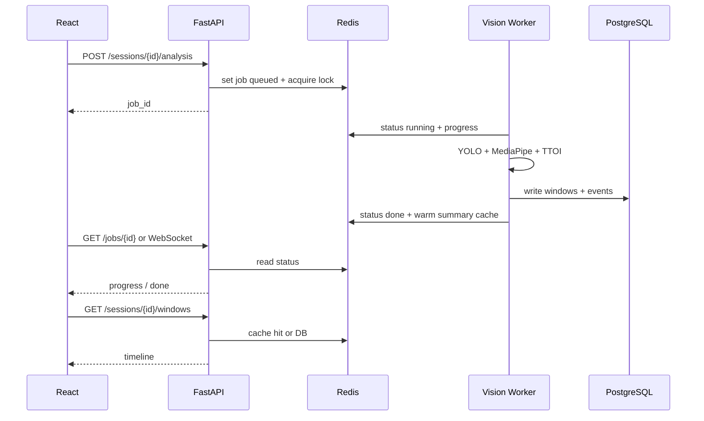

# VIGILENS — Complete Idea & Final Plan

### The single authoritative document for what this project is, why it exists, and how it will be built

| | |
|---|---|
| **Document status** | **Authoritative / final idea file** |
| **Date** | 17 October 2026 (updated: review fixes — auth, schema, API, timeline) |
| **Project name** | VIGILENS — A Clearer Lens on Learning |
| **Short name** | Classroom Engagement Trend Analyzer |
| **Replaces as source of truth** | Older planning docs below are background only |

> **This is the only project plan file.** Older drafts and the research audit were merged here and removed to avoid confusion.
>
> **If anything conflicts with this file, this file wins.**

---

## 1. The idea in one breath

**VIGILENS is a local, privacy-first computer-vision system that helps a lecturer (and, for reflection, the class) answer three questions after a lecture:**

1. **When** did the class’s *visible* orientation / participation cues change?
2. **How reliable** is that reading (was the camera actually seeing enough people)?
3. **Which topic or slide** was being taught at that moment?

It does **not** read minds, detect “boredom,” identify students by name, or grade anyone.

**One-line pitch:**  
*A clearer lens on learning — not mind-reading.*

**Consent status (project fact):** Institutional approval is already in place (Principal + Dean letters). Students have signed consent. Work may proceed with real classroom sessions under that approved protocol. Privacy design (no face recognition, no grading use, aggregate-first retention) still applies.

---

## 2. Why this project exists

### The real problem
A lecturer cannot watch 40–100 faces while teaching. After class they may feel “that section dragged,” but they usually cannot say:

- At **which minute** the room’s visible behaviour shifted
- Whether that shift happened during **Topic 3**, a long monologue, or a diagram copy-down
- Whether the camera evidence was even good enough to trust

Today, pacing, examples, and breaks are tuned mostly by **guesswork and memory**.

Students also benefit indirectly: class-level timelines show **when focus patterns dip for the group**, so teaching and self-study habits can improve. That does **not** require naming or ranking individuals.

### What the professor originally asked for
Something that uses a camera + image processing / ML to observe students and show **when attention drops**, ideally linked to **which concept** was being taught, so teaching can improve.

### What that request really means (engineering truth)
A camera cannot measure “attention” or “interest.” Those are internal. A camera can only measure **observable behaviour** — for example:

- Are heads/bodies broadly facing the board / lecturer / screen?
- Are many heads down for a long stretch?
- Did anyone visibly raise a hand during Q&A?

So the project must be honest:

> We estimate **class-level observable engagement proxies**, detect **candidate decline periods**, attach them to **lecture topics**, and always show **data quality**.

That is the real idea. Everything else is implementation detail.

---

## 3. What VIGILENS is — and is not

### It is
| Aspect | Meaning |
|---|---|
| **A teaching-reflection tool** | Helps the lecturer review lecture flow |
| **A proper software system** | FastAPI backend + React frontend + PostgreSQL + Redis — not a Streamlit-only demo |
| **Class-level** | Main product is one trend for the room, not a “bad students” list |
| **Proxy-based** | Orientation and related visible cues — not true attention |
| **Uncertainty-aware** | Low coverage → “insufficient visual evidence,” not a fake score |
| **Context-aware** | Note-taking mode does not treat head-down as failure |
| **Privacy-first** | Local processing by default, no face recognition, delete raw video after analysis |
| **Consented** | Principal, Dean, and student consents already obtained |
| **Validated** | Human annotators + anonymous student pulse checks |
| **Offline-first analytics** | Post-lecture analysis is the MVP path; live preview can be added once the pipeline is solid |

### It is not
| Anti-idea | Why rejected |
|---|---|
| Mind-reading / emotion AI (“bored,” “confused”) | Facial expressions do not reliably equal internal states |
| Named individual rankings for discipline | Unfair and outside teaching-reflection purpose |
| Face recognition / identity matching | Unnecessary for class-level improvement |
| Grading or attendance penalties | Explicitly out of scope |
| A claim that looking-at-board = learning | Orientation ≠ comprehension |
| Streamlit-only “demo app” as the product | Too lightweight for a proper system; we build real API + UI |
| A “first ever attention detector” | Differentiate by timeline + coverage + context + proper software + validation |

### What makes this project meaningfully different
Classroom engagement CV is **not new** (see §3.1). We do **not** claim invention of the idea. Our contribution is this combination, validated locally:

1. Transparent **TTOI** (observable orientation — not mental attention)
2. **Coverage / uncertainty gating** as a first-class output
3. **Class-level only** main product (no named student rankings)
4. **Fixed seat regions** (no identity tracking across lectures)
5. Teaching-context modes (explanation vs note-taking vs Q&A)
6. Lecture **topic markers** + candidate-decline timeline
7. Human validation (annotators + anonymous pulse checks)
8. Privacy-first local processing under existing institutional consent
9. **Production-shaped stack:** FastAPI + React + PostgreSQL + Redis

**Defensible research question (use this in reports):**
> Can a fixed classroom camera provide reliable, privacy-preserving, class-level trends in observable teaching-target orientation, and can those trends help a lecturer identify time windows worth reviewing when aligned with lecture topics?

### Branding note (action required in Phase 0)
A site at [vigilens.in](https://www.vigilens.in/) already uses a similar “VigiLens” name for **security/surveillance** CV — not classroom learning. **Decide with the professor in Week 1** whether the academic report/demo keeps “VIGILENS” or uses a subtitle/alternate public name. Do not leave this until the final presentation.

---

## 3.1 Prior work & reuse decisions (from research audit)

Below are the **locked reuse decisions** for implementation (from the prior-art research scan).

### Closest prior work — acknowledge, do not copy as “ours”

| Prior work | Overlap | How we stay distinct |
|---|---|---|
| **Virginia Tech / UVA classroom observation framework** | Pose/posture, privacy delete-after-features, instructor timelines | Their public description includes per-student behavioural timelines; we keep **class-level TTOI + seat regions + coverage gating + topic modes** as the core product |
| **Mental Edge** (commercial) | Timestamped aggregate video analytics for teachers | They emphasize facial-movement / FACS-style summaries; we emphasize **orientation to teaching target, coverage, context modes, candidate declines** |
| **2025 IEEE classroom YOLO / concentration papers** | Real-time posture / expression “attention” systems | We reject emotion→concentration as the main claim; we ship explainable TTOI + uncertainty |
| **Open-source demos** (fyp-attention-monitoring, classroom-engagement-analyzer, TeachPulse-AI, ClassAI, Modulator) | YOLO + MediaPipe + dashboards; TeachPulse even uses FastAPI/React | Study for engineering patterns only; **check licenses**; do not copy attendance/ID/emotion designs; our metric + privacy + coverage story differs |

### What we WILL reuse / study (actionable)

| Asset | Decision | How we use it | When |
|---|---|---|---|
| **OUC-CGE dataset + baseline repo** | **Reuse for research** | Best public *group-level classroom* video set. Prefer **GitHub** ([oucyy361/OUC-CGE](https://github.com/oucyy361/OUC-CGE)) if OSF is flaky; verify terms; cite paper. **Never treat ~97% accuracy as our classroom accuracy.** | Week 1–2 research track |
| **YOLOv8-pose (Ultralytics)** | **Production primary** | Already locked — person + pose for the full room | MVP |
| **MediaPipe Face Landmarker** | **Production Tier-2** | Already locked — head pose when faces are large enough | MVP |
| **MediaPipe Pose Landmarker** | **Optional helper / debug** | Useful for visualizing torso geometry; YOLO-pose remains primary for multi-person classroom. If using MediaPipe Pose, raise `num_poses` — default is 1 | Early vision debug |
| **OpenVINO `person-detection-action-recognition-0006`** | **Optional Phase-2 baseline** | Pretrained actions: sitting, writing, hand-raise, standing, turned around, lying on desk. Use as a **comparison cue** for hand-raise / writing vs our geometry rules — only where people are large enough (~80 px height). Review Open Model Zoo license before shipping weights | After MVP TTOI works |
| **TeachPulse-AI / similar FastAPI+React repos** | **Architecture reference only** | Study WebSocket job progress / dashboard layout ideas; rewrite ourselves; respect licenses | While building backend/frontend |
| **DAiSEE** | **Secondary / literature only** | Understand online-engagement research; do **not** expect transfer to far classroom seats | Optional notebook |
| **Local consented lectures** | **Essential** | Final truth for our room, camera, lighting, teaching style | Weeks 4–7 |

### What we will NOT reuse as product path

| Asset | Why not |
|---|---|
| Hugging Face DAiSEE engagement weights (e.g. EfficientNet F1 ≈ 0.33) | Wrong domain + weak metrics; not a classroom API |
| OUC-CGE SlowFast / I3D / X3D as the **main** VIGILENS model | Heavy, opaque, trained on a small scripted group set; OK only as research comparison |
| DIPSER multimodal biometric suite | Too individual/sensitive for MVP; inspect later only if a feature is blocked |
| OpenVINO gaze pipeline as whole-class attention | Needs clear eyes/faces; fails on far seats; not our primary metric |
| Emotion / “concentration from facial expression” papers’ approach | Conflicts with our philosophy |
| Modulator-style individual ID tracking | Privacy model incompatible |
| ClassAI-style attendance features | Out of scope |
| Blind copy-paste of any GitHub demo | License, quality, and privacy risk |

### Dataset strategy (locked order)
1. **Scaffold software + YOLO/MediaPipe on our camera** (primary path).  
2. **In parallel:** request/download **OUC-CGE** (if terms OK) → one notebook reproducing their group-engagement baseline → write a short “what transfers / what does not” note.  
3. Use **DAiSEE** only if needed for literature comparison.  
4. **Validate only on our consented classroom sessions** for any claim about the professor’s lectures.  
5. If we ever train a temporal model on OUC-CGE, evaluate it on **held-out local sessions** before trusting it.

---

## 4. Finalized design decisions (locked)

| # | Decision | Final choice | Rejected alternative |
|---|---|---|---|
| 1 | Primary metric | **TTOI** — Teaching-Target Orientation Index | Per-student “attention score” as the main product |
| 2 | Observation unit | **Fixed seat regions** | Free person tracking as the default unit |
| 3 | Output level (MVP) | **Class-level teacher dashboard** | Named individual scoreboards |
| 4 | Evidence quality | **Coverage % + “unobservable”**; suppress alerts when coverage is low | Inventing a score when the camera cannot see |
| 5 | Scoring style | **Separate transparent signals** | One secret blended score in MVP |
| 6 | Vision models | **YOLOv8 (Ultralytics) person + pose primary**; **MediaPipe Face Landmarker for Tier-2 head pose** | Training detectors from scratch; emotion CNNs; MediaPipe-only for full classroom |
| 7 | Training strategy | **Use pretrained YOLO/MediaPipe**; train only a **lightweight classifier on geometric features** later if it beats rules | Fine-tuning huge video transformers first |
| 8 | Facial emotion | **Excluded** | Soft emotion feature |
| 9 | Phone / drowsiness | **Phase 2 secondary cues** (YOLO phone class + EAR/MAR where faces are large) | Inside MVP score |
| 10 | Audio / Whisper | **Off by default** | Automatic speech topics in MVP |
| 11 | Analysis mode | **Upload / record → analyze job** first; optional live webcam preview next | Live alerts as day-one blocker |
| 12 | UI / API | **FastAPI backend + React frontend from MVP** | Streamlit as the product UI |
| 13 | Database | **PostgreSQL** for durable session/window/event data | MongoDB as primary store |
| 14 | Cache | **Redis** for job status, hot session summaries, short-lived analysis caches | No cache / only DB hits for every chart refresh |
| 15 | Camera sources | **Laptop webcam**, **uploaded MP4**, **mobile phone camera** (IP Webcam / DroidCam / RTSP) | Fixed IP camera only |
| 16 | Consent | **Already obtained** (Principal, Dean, students) | Blocking on new consent paperwork |
| 17 | Retention | Process video → store **aggregates + config**; delete / purge raw video after successful analysis (keep longer only if annotation needs it) | Keeping all classroom video forever |
| 18 | Coverage threshold (start) | **~70%** usable / expected occupied seats (tune on pilot) | Older 50% mention |
| 19 | Window size | **30-second** class windows | Per-second individual product scoring |
| 20 | Public group dataset | **OUC-CGE for research/baseline notebooks only** | Treating OUC-CGE accuracy as production classroom performance |
| 21 | Optional action model | **OpenVINO action-recognition as Phase-2 comparison** for hand-raise/writing | Replacing TTOI with OpenVINO “engagement” |
| 22 | Novelty claim | **No “first ever” claim** — differentiate on TTOI + coverage + topics + privacy + local validation | Claiming invention of classroom engagement CV |
| 23 | Head-pose angles | **θ_yaw = 30°**, θ_pitch_down ≈ 20° (README must match) | Mixing ±35° and ±30° |
| 24 | MediaPipe API | **Face Landmarker Task API** (`mediapipe.tasks.vision`); landmark topology same as classic FaceMesh indices | Mixing legacy `solutions.face_mesh` init with Task API text |
| 25 | Auth (MVP) | **JWT for lecturer**; `/pulse/*` anonymous/public | Full OAuth / multi-tenant IAM in week 1 |
| 26 | Job queue (MVP) | **One analysis job at a time per machine** (Redis lock); re-run replaces previous unfinished job for that session | Unbounded parallel heavy GPU jobs |
| 27 | Export (MVP) | **CSV required**; PDF deferred (Phase 2, e.g. WeasyPrint) | Blocking MVP on PDF polish |
| 28 | Runtime | **Python 3.10+**, **Node.js 18+** | Unspecified versions |

---

## 5. Software system architecture (MVP stack — locked)

We are **not** building a Streamlit-only prototype as the product. Streamlit may be used only as a temporary internal debug notebook UI if needed. The real system is:

```text
┌─────────────────────────────────────────────────────────────────┐
│                     React Frontend (Vite)                        │
│  Session setup · Camera / upload · Topic markers · Timeline UI  │
│  Coverage chart · Candidate events · Export · Pulse-check QR    │
└────────────────────────────┬────────────────────────────────────┘
                             │  REST (+ optional WebSocket for job progress)
                             ▼
┌─────────────────────────────────────────────────────────────────┐
│                     FastAPI Backend                              │
│  /sessions  /topics  /analysis  /windows  /events  /pulse        │
│  Auth for lecturer operator · job queue hooks · report export    │
└───────────────┬─────────────────────────────┬───────────────────┘
                │                             │
                ▼                             ▼
┌──────────────────────────┐    ┌──────────────────────────────┐
│ PostgreSQL               │    │ Redis                         │
│ sessions, room configs,  │    │ analysis job status           │
│ windows (TTOI…), events, │    │ cached session summaries      │
│ topics, pulse responses  │    │ short-lived feature caches    │
└──────────────────────────┘    └──────────────────────────────┘
                │
                ▼
┌─────────────────────────────────────────────────────────────────┐
│              Vision / Analytics Worker (Python)                  │
│  OpenCV ingest → YOLO person/pose → MediaPipe face (Tier-2)     │
│  seat regions → features → TTOI aggregation → decline detection │
│  Writes results to PostgreSQL; updates Redis job progress       │
└─────────────────────────────────────────────────────────────────┘
                ▲
                │
   Laptop webcam · Mobile phone stream · Local MP4 upload
```

### Why this stack
| Piece | Why locked |
|---|---|
| **FastAPI** | Fast Python API, easy to call the CV pipeline, OpenAPI docs, WebSocket-friendly for job progress |
| **React (Vite)** | Proper teacher UI, charts, session workflow, not a throwaway demo shell |
| **PostgreSQL** | Our data is relational + time-window structured; SQL analytics are natural; strong consistency for sessions/events |
| **Redis** | Cache job progress and hot read paths so the React timeline does not hammer Postgres on every poll |
| **Python worker** | Same language as OpenCV / Ultralytics / MediaPipe; can run in-process for MVP or as a background task |

### MongoDB — why not primary
MongoDB is fine for loose documents, but VIGILENS data is:

- sessions → many windows → many events → topics → pulse rows

That is a **relational timeline**. PostgreSQL wins for queries like “all candidate declines for Topic 3 across sessions with coverage ≥ 70%.”  
**Decision: PostgreSQL primary. Do not use MongoDB as the main store.** (Optional JSON columns in Postgres are enough if we need flexible config blobs.)

### Caching strategy (required, not optional polish)
| What | Where | TTL / rule |
|---|---|---|
| Analysis job status (`queued` / `running` / `%` / `done` / `error`) | Redis | Until job finishes + short retain |
| Session summary (mean TTOI, coverage, event count) | Redis | Invalidate on analysis complete / delete |
| Timeline windows payload for open session | Redis | Invalidate when analysis rewritten |
| Room/camera config | Postgres (source of truth); Redis optional | Invalidate on config save |
| Raw video / frame tensors | **Disk temp only**, never Redis, never long-term DB | Delete after analysis |

### Camera ingestion (locked options)
| Source | How | Use |
|---|---|---|
| **Laptop webcam** | OpenCV `VideoCapture(0)` | Dev + small demos + live preview |
| **Mobile phone camera** | Phone runs **IP Webcam / DroidCam / similar** → HTTP or RTSP URL into OpenCV | Classroom when a phone mount is easier than a USB cam |
| **Uploaded recording** | Lecturer uploads MP4/WebM to FastAPI → worker analyzes offline | Main MVP path (most reliable) |
| Fixed IP camera (optional later) | RTSP URL in room config | Same ingest path as mobile RTSP |

**MVP camera UX in React:**
1. Choose source: Upload file / Webcam / Phone stream URL  
2. Optional short live preview to aim the camera  
3. Start session → record or upload → Run analysis job  
4. Watch job progress → open timeline

### 5.1 Platform engineering locks (from review)

| Topic | Locked approach |
|---|---|
| **Auth** | Single lecturer (or small shared) account via **JWT** (access token). Protect all `/sessions`, `/rooms`, `/jobs`, `/export` routes. **`POST /pulse/{session_id}` is public** (no JWT) but rate-limited; no PII accepted. |
| **CORS** | FastAPI `CORSMiddleware` allows React Vite origin (`http://localhost:5173`) in dev. Production: same-origin reverse proxy (e.g. Nginx) or explicit allowed origin list. |
| **Config / secrets** | Pydantic Settings + `.env` (`DATABASE_URL`, `REDIS_URL`, `SECRET_KEY`, `UPLOAD_DIR`, `MAX_UPLOAD_MB`, model paths). Commit `.env.example` only. |
| **Uploads** | Default `MAX_UPLOAD_MB` ≈ **2048** (2 GB). Prefer streaming upload to disk; reject oversize. Chunked/resumable upload = Phase 2 if needed. Temp video under `UPLOAD_DIR`; purge after analysis. |
| **Jobs** | Redis key `lock:analysis` (or per-session). **One active heavy job** at a time on the MVP machine. Status: `queued` → `running` → `done` / `error`. Timeout + `error_message` on failure. Re-analysis for a session cancels/supersedes that session’s unfinished job. |
| **Logging** | stdlib `logging` (or `structlog`) JSON-ish lines from API + worker; surface worker failures in `analysis_jobs.error_message` for the UI. |
| **Testing** | Unit tests for aggregation / decline / coverage; FastAPI route tests with TestClient; a few **fixture frames** for vision smoke tests (no real classroom video in git). |
| **PDF** | MVP export = **CSV** (and JSON via API). PDF = Phase 2. |

### Analysis job sequence (Mermaid)



---

## 5.2 Seat regions & teaching-target geometry

| Topic | Locked approach |
|---|---|
| **Seat regions** | Drawn once per **room config** as polygons (or axis-aligned boxes) on a calibration frame in React; stored in `room_configs.seat_regions_json`. Reused across sessions for that room. |
| **`N_expected`** | During calibration (first ~1–3 min or a short “look at board” clip): a seat is **occupied** if a person is detected in that region in ≥ ~50% of calibration samples. `N_expected` = count of occupied seats (not empty chairs). Manual override allowed. |
| **Teaching target** | A **static ROI** (polygon or box) — usually board/screen area — stored as `target_roi_json`. Centroid of that ROI defines the expected facing direction. |
| **`yaw_baseline_i`** | Expected yaw from seat `i` toward the target centroid (from geometry and/or median pose during calibration “face the board” window). Relative angles: `yaw' = yaw - yaw_baseline_i`. |
| **Lecturer movement** | MVP target = **board/screen zone**, not a moving person tracker. If the lecturer teaches from a different wall, operator updates/switches target ROI (or room preset). |
| **Mode history** | Mid-lecture mode switches go into a **`mode_changes`** table (timestamped), same idea as topics — not a single field on `sessions` alone. |

---

## 6. Models & training — final choices (no more confusion)

### 6.1 What we use out of the box (do not train these first)

| Component | Locked choice | Why this, not the others |
|---|---|---|
| **Person detection + body pose** | **Ultralytics YOLOv8** (`yolov8n-pose` or `yolov8s-pose`) | Best practical multi-person classroom detector+pose in one model; pretrained on COCO; easy Python API; good speed/accuracy on a laptop GPU/CPU |
| **Head pose (Tier-2, when face is large enough)** | **MediaPipe Face Landmarker Task API** + `solvePnP` / facial matrix | Use `mediapipe.tasks.vision.FaceLandmarker`. Landmark **index numbers** match the classic 478-point FaceMesh topology; do **not** init via legacy `mp.solutions.face_mesh` in new code |
| **Phone detection (Phase 2)** | **YOLO pretrained `cell phone` class** (same Ultralytics family) | No custom phone dataset needed at start |
| **Eye / yawn cues (Phase 2, near seats only)** | EAR / MAR from MediaPipe landmarks | Classic, explainable; only when resolution supports it |
| **Action comparison (Phase 2, optional)** | **OpenVINO `person-detection-action-recognition-0006`** | Writing / hand-raise / turned-around labels as a **baseline to compare** against our geometry rules; people must be large enough in frame |

**Rejected for MVP as primary path:**
- Training YOLO / MediaPipe from scratch — unnecessary and data-hungry  
- Emotion recognition models — out of scope  
- End-to-end VideoMAE / SlowFast / OUC-CGE video classifiers as the **main** system — heavy, opaque; **research benchmark only**  
- Hugging Face DAiSEE “student engagement” checkpoints — wrong domain, weak reported F1  
- MediaPipe-only for a full far classroom — weak when many small/far people; YOLO-pose covers the room better  
- InsightFace / face-recognition stacks — identity risk; not needed  
- OpenVINO gaze as whole-class attention — fails on far seats

### 6.2 How models are obtained
1. Install `ultralytics` → first run downloads **official pretrained** `yolov8n-pose.pt` (or `s`) weights.  
2. Install `mediapipe` → uses Google’s published Face Landmarker bundle.  
3. (Phase 2 optional) Download OpenVINO Open Model Zoo action model; record license in `docs/`.  
4. Store model paths under `models/` or let libraries cache them; **do not commit huge weights if avoidable** — document download in setup.  
5. Pin versions in `requirements.txt` so results are reproducible.

### 6.3 What we actually “train” (and when)

| Stage | What | Method | Gate |
|---|---|---|---|
| **A — MVP (now)** | Rule-based orientation / head-down / hand-raise from pose geometry | **No training** — thresholds in `configs/default.yaml` | Ship this first |
| **B — After labeled pilot** | Observable-state classifier: `target_oriented`, `not_target_oriented`, `head_down_cue`, `hand_raised`, `unobservable` | **scikit-learn / XGBoost** on geometric features (yaw', pitch', torso angle, durations, confidence, tier, mode) | Keep **only if** macro-F1 beats Stage A on held-out **local** sessions |
| **R — Research track** | Reproduce OUC-CGE published baseline (Slow-only / etc.) in a notebook | Learn group-video pipeline; write transfer limitations | Does **not** replace Stage A as product |
| **C — Optional later** | Lightweight temporal model or OpenVINO action rates vs TTOI | Benchmark on held-out local lectures | Ship only if better **and** still explainable |

**Best training option for this project:**  
**Do not fine-tune YOLO first.** Use pretrained YOLO + MediaPipe. Use OUC-CGE to learn/compare, not to fake classroom accuracy. Invest labeling effort into Stage B (small tabular/geometry classifier) on **our** consented data. That is the highest ROI path.

### 6.4 Capability tiers (still required)
| Tier | Condition | What runs |
|---|---|---|
| **Tier 1 — Body** | Upper body visible, face tiny | YOLO-pose torso/shoulder orientation, hand-raise, presence |
| **Tier 2 — Head** | Face width ≳ 80–100 px | MediaPipe head yaw/pitch, head-down, later EAR/MAR |
| **Tier 3 — Close-up** | Face very large | Not required for MVP claims |

---

## 7. How the system works (end-to-end story)

```text
1. BEFORE CLASS
   - Consent already in place (Principal, Dean, students)
   - Place laptop webcam or phone camera (front / front-side, slightly elevated)
   - In React: create session → load room config → draw seat regions + teaching target
   - Choose teaching mode (Explanation / Note-taking / Q&A…)

2. DURING / AFTER CLASS
   - Record via webcam/phone OR upload MP4
   - Teacher presses “new topic” in the UI at topic changes
   - Optional: students scan QR for anonymous 1–5 pulse checks

3. PROCESSING (FastAPI job → Python worker, local machine)
   - Sample ~1–2 frames per second
   - YOLO person/pose per frame → map detections into seat regions
   - Tier-2 faces → MediaPipe head pose
   - Aggregate every 30 seconds → TTOI + coverage + secondary rates
   - Smooth; flag candidate declines only if coverage is good
   - Write windows/events to PostgreSQL; cache summary in Redis

4. TEACHER SEES (React)
   - TTOI timeline, grey low-coverage zones, confidence band
   - Candidate events linked to topics
   - Separate head-down / participation charts
   - Export CSV / PDF (no faces, no names)

5. AFTERWARDS
   - Purge raw video from temp storage (default)
   - Keep aggregates, topics, events, configs in PostgreSQL
```

### Analysis job lifecycle
```text
React "Run analysis"
   → POST /sessions/{id}/analysis
   → FastAPI enqueues job, sets Redis status = queued
   → Worker: running (progress % in Redis)
   → Worker writes windows/events to PostgreSQL
   → Redis status = done; summary cache warmed
   → React polls or WebSocket → renders timeline
```

---

## 8. Core metric: TTOI (explained simply)

### Name
**Teaching-Target Orientation Index (TTOI)**

### Plain meaning
In each 30-second window:

> Of the seats we could actually see well enough, what fraction of the time were those people broadly facing the current teaching target (board / lecturer / screen)?

### Formal idea
- Room is split into **seat regions**
- Each region in a window is either **usable** or not
- For usable regions, compute how often orientation was “aligned” with the teaching target
- Average across usable regions → **TTOI** (0–100)
- Also compute **Coverage** = usable regions / occupied expected regions

### Honest interpretation
| TTOI = 72 means… | TTOI does **not** mean… |
|---|---|
| About 72% of usable observations faced the teaching target | 72% of students were mentally attentive |
| A useful class trend to review | Someone is bored / lazy / failing |
| Something an annotator can verify from video | Proof that Topic 3 is a bad topic |

### Coverage rule (critical)
If coverage is too low (start: below ~70%, or fewer than ~5 usable seats):

- Do **not** invent a precise TTOI story
- Mark the window **“insufficient visual evidence”**
- Do **not** fire a decline alert

### Partial / boundary windows
- Windows with **&lt; 15 seconds** of usable sampled data (start/end of lecture, or gaps) → mark `data_quality_note = partial_window`, set TTOI = NaN (or show with explicit caveat), **never** fire a decline alert from a partial window alone.
- Full 30 s windows are the default unit for trends and events.

### Secondary signals (shown separately)
| Signal | Role |
|---|---|
| Head-down cue rate | Pattern worth reviewing; often note-taking |
| Hand-raise / participation | Useful mainly in Q&A |
| Device-use cue (Phase 2) | YOLO phone + head-down, if resolution allows |
| Drowsiness cue (Phase 2) | EAR/MAR — near seats only |

### Context modes
| Mode | How interpretation changes |
|---|---|
| **Explanation** | Facing the teaching target is the main positive signal |
| **Note-taking / Independent work** | Head-down expected; do not treat as decline |
| **Q&A** | Show participation events |
| **Discussion** | Orientation toward speaker may matter more than board |

---

## 9. Candidate decline detection

We do **not** say “attention dropped.” We say:

> **Candidate orientation decline** — an observable class-level change worth reviewing.

### MVP logic
1. Smooth TTOI (~90 s rolling median)
2. Compare to recent baseline (~last 3 minutes)
3. Flag only if coverage OK, drop ≥ ~10 points (later noise-calibrated), and persists ≥ 2 windows
4. Later: CUSUM (slow drift) + change-point regimes

**Event `depth`:** the drop magnitude in TTOI percentage points for that event — typically `max(Baseline − TTOI_smooth)` over the flagged span (not a nesting level, not raw CUSUM `S_t`). Store as a float on `events.depth`.

### Correct wording
> **18:30–19:30 — Possible orientation decline.** TTOI fell ~13 points vs. recent baseline. Coverage 80%. Topic 3 active. Observable change only — not a direct measure of interest.

---

## 10. Linking trends to lecture content

| Method | Phase | Notes |
|---|---|---|
| Manual “new topic” in React UI | **MVP** | Primary |
| Slide / screen change detection | Phase 2 | Optional |
| Whisper audio topics | Optional later | Extra consent; off by default |

Topic labels are **context**, not proof of cause.

---

## 11. What we will actually build

### MVP (proper software, first useful product)
1. **Monorepo layout:** `backend/` (FastAPI) + `frontend/` (React) + `worker/` or `src/vigilens/` (CV pipeline)
2. PostgreSQL schema: sessions, room_configs, topics, windows, events, pulse_responses
3. Redis: job status + summary/timeline cache
4. Camera ingest: webcam, phone URL, file upload
5. Seat-region + teaching-target setup in React (or config JSON uploaded)
6. YOLO-pose + MediaPipe Tier-2 head pose pipeline
7. Rule-based TTOI + coverage + candidate declines
8. Topic markers + Explanation / Note-taking modes
9. React teacher dashboard: timeline, events, coverage, **CSV** export
10. Temp video purge after analysis (`DELETE .../video` or automatic)

**MVP success:**  
Create session → ingest webcam/phone/upload → run analysis job → see TTOI timeline with coverage + candidate declines + topics in React — no Streamlit required.

### Phase 2
- Annotation tooling workflow + labeled pilot from consented class
- XGBoost/sklearn observable classifier vs rule baseline
- Pulse-check QR page
- Optional PDF export (e.g. WeasyPrint)
- Device / drowsiness cues where tiers allow
- Segment ranking, model card, evaluation notebook

### Explicitly out of version 1
Face recognition · emotion labels · grading/discipline · MongoDB primary · Streamlit-as-product · mandatory cloud video APIs · audio-by-default · “this technique caused the drop” automation

---

## 12. Database schema (PostgreSQL — locked)

Minimal tables (one row per aggregate window — **not** per face):

```text
rooms / room_configs
  id, name, seat_regions_json, target_roi_json, camera_defaults, created_at

sessions
  id, room_config_id, title, started_at, ended_at,
  source_type (upload|webcam|phone_rtsp), status, created_at
  (current mode is derived from latest mode_changes row; optional denormalized current_mode cache OK)

topics
  id, session_id, start_sec, end_sec, label

mode_changes
  id, session_id, start_sec, mode   # explanation | note_taking | qa | discussion | ...

windows
  id, session_id, start_sec, end_sec, topic_id, teaching_mode,
  expected_regions, usable_regions, coverage_pct,
  ttoi, ttoi_lo, ttoi_hi, head_down_cue_pct, hand_raise_events,
  candidate_decline, dominant_cue, data_quality_note

events
  id, session_id, start_sec, end_sec,
  depth,              # TTOI drop magnitude in percentage points (see §9)
  coverage_pct, topic_id, teaching_mode, dominant_cue, note

pulse_responses
  id, session_id, topic_id, score_1_to_5, created_at
  (no student name / seat / roll number)
  # topic_id: server assigns the session's active topic at submit time
  # (latest topic with start_sec <= now); QR only needs session_id

analysis_jobs
  id, session_id, status, progress_pct, error_message, created_at, finished_at
```

**Never store:** face embeddings, names, roll numbers, student IDs, raw face crops, permanent per-student histories.

**Pulse-check flow:** QR → public page for `session_id` → student submits 1–5 → API stamps `topic_id` from the active topic marker (or null if none). No student identity.

Redis keys (examples):
```text
job:{job_id}:status
session:{id}:summary
session:{id}:windows
```

---

## 13. How we know it works (validation)

| Layer | Purpose |
|---|---|
| Human annotation of **visible** actions only | Technical truth |
| Anonymous pulse checks | Student-side usefulness |
| Lecturer (and cohort) usefulness of the timeline | Practical success |

Annotators never label “bored/confused” from a face. “Uncertain” is valid.

| ID | Criterion | Target |
|---|---|---|
| S1 | Readable class trend in React after analysis job | Required |
| S2 | Low-coverage windows marked / alerts suppressed | Required |
| S3 | Optional ML beats rule baseline on held-out sessions | Or drop ML |
| S4 | Annotator κ ≥ ~0.6 on double-labelled set | Target |
| S5 | Decline events vs human marks (±30 s) | Report honestly |
| S6 | API + UI usable end-to-end without Streamlit | Required |
| S7 | Raw video purged by default after analysis | Required |

---

## 14. Data reality & consent

### Consent (current project status)
- Principal approval: **obtained**
- Dean approval: **obtained**
- Student consent letters: **obtained**
- Therefore Phase 0 is **not** blocked on paperwork; still keep notices visible in the app and honour any individual opt-out seating if the institution requires it.

### Public datasets (reuse plan)

| Dataset | Role for us | Caution |
|---|---|---|
| **OUC-CGE** ([GitHub](https://github.com/oucyy361/OUC-CGE) preferred; [OSF](https://osf.io/BRD2C/) if available; [paper](https://pmc.ncbi.nlm.nih.gov/articles/PMC12003871/)) | **Primary public reuse** — group engagement clips + baseline code | Small/scripted cohort; ~97% will **not** transfer; OSF may be flaky — use GitHub fallback; verify terms; cite always |
| **DAiSEE** | Secondary literature / close-up engagement experiments | Webcam e-learning, not far classroom |
| **DIPSER** | Optional later feature research only | Multimodal / individual-sensitive — not MVP |
| **Our consented classroom video** | **Only source of truth** for final claims | Already approved; still purge raw video after analysis |

### Local data plan
1. **Stage A:** Short scripted clips to tune thresholds quickly  
2. **Stage B:** Real consented lectures with topic markers + optional pulse checks  
3. **Parallel research:** OUC-CGE baseline notebook + short “transfer gap” write-up for the report  

Test farthest seats first. If faces are tiny → Tier 1 body orientation only + honest coverage.

---

## 15. Privacy & responsible use (still non-negotiable)

Consent exists; that does **not** mean we build a surveillance or grading product.

1. Show in-app notice of purpose and retention  
2. Local processing by default  
3. No face recognition / identity matching  
4. No grading, attendance penalties, or discipline rankings  
5. Class-level aggregates as the primary stored product  
6. Purge raw video after analysis (unless short annotation hold is approved)  
7. No faces in exports by default  
8. Align with DPDP + institutional policy (confirm locally; this is not legal advice)

**Design test:** if a feature needs naming a student to be useful for the MVP teacher report, leave it out.

---

## 16. Repository structure (target)

```text
vigilens/
├── README.md
├── docker-compose.yml                 # Postgres + Redis
├── .gitignore                         # models/, .env, uploads/, venv, node_modules, __pycache__…
├── .env.example
├── docs/
│   └── VIGILENS_COMPLETE_IDEA.md      # this file (sole plan)
├── backend/                           # FastAPI
│   ├── app/
│   │   ├── main.py
│   │   ├── api/                       # rooms, sessions, topics, analysis, windows, events, pulse
│   │   ├── core/                      # settings, auth, cors, logging
│   │   ├── db/                        # SQLAlchemy models
│   │   ├── cache/                     # Redis helpers
│   │   └── services/
│   ├── requirements.txt               # pin versions; Python >=3.10
│   └── alembic/                       # Postgres migrations
├── worker/                            # CV pipeline
│   ├── capture.py
│   ├── vision_yolo.py
│   ├── vision_mediapipe.py            # Face Landmarker Task API
│   ├── regions.py
│   ├── features.py
│   ├── aggregation.py
│   ├── drop_events.py
│   └── jobs.py
├── frontend/                          # React + Vite (Node >=18)
│   ├── package.json
│   └── src/
├── configs/
│   ├── default.yaml
│   └── camera_room.yaml
├── notebooks/                         # OUC-CGE / evaluate_pilot
├── models/                            # gitignored weights
├── data/                              # sample aggregates only in git
└── tests/                             # unit + API + fixture-frame vision smoke
```

---

## 17. Action plan — what exactly must be done

### Phase 0 — Lock & scaffold (Week 1) — consent already done
- [x] Institutional + student consent obtained  
- [x] Prior-art / reuse decisions locked (see §3.1); obsolete planning drafts deleted  
- [ ] Confirm with professor: proxy wording (TTOI); no “first ever” claim; **branding decision** (VIGILENS vs alternate public name)  
- [ ] Scaffold monorepo: FastAPI + React + `.env.example` + `.gitignore`  
- [ ] `docker-compose.yml` for Postgres + Redis  
- [ ] **Alembic** init + first migration for schema in §12  
- [ ] CORS + JWT auth stub + public `/pulse` exemption  
- [ ] Start OUC-CGE via **GitHub** (OSF fallback); skim VT + Mental Edge for related-work  
- [ ] Lock this document as the definition  

### Phase 1 — Vision baseline (Weeks 2–4)
- [ ] OpenCV ingest: webcam, file, phone RTSP/HTTP URL (respect `MAX_UPLOAD_MB`)  
- [ ] YOLOv8-pose on classroom frames; seat-region mapping (§5.2)  
- [ ] MediaPipe **Face Landmarker Task API**; **verify yaw/pitch signs on real frames** (look L/R/U/D) before trusting unwrap  
- [ ] Occupied-seat calibration + face-width tiers + teaching-target ROI  
- [ ] First TTOI curve on a short real/scripted clip (partial-window policy applied)  
- [ ] Tune thresholds on scripted behaviours  
- [ ] Unit tests for aggregation / coverage / decline helpers  
- [ ] **Research track:** OUC-CGE baseline notebook + 1-page transfer-gap note  

### Phase 2a — Backend MVP (Week 5)
- [ ] FastAPI: rooms CRUD, sessions list/detail, topics, mode_changes, analysis jobs, windows, events  
- [ ] Redis job lock + progress + summary cache  
- [ ] Postgres persistence; one-job-at-a-time semantics  
- [ ] CSV export; `DELETE .../video` purge  
- [ ] Worker wired to write real/fake aggregates  

### Phase 2b — Frontend MVP (Week 6)
- [ ] React: room setup, upload/webcam/phone, run job, timeline + events + coverage  
- [ ] Topic + mode controls; candidate decline overlay  
- [ ] **MVP demo ready (no Streamlit, CSV export)**  

### Phase 3 — Pilot & truth (Weeks 7–8)
- [ ] Real consented lectures through the app  
- [ ] Annotation guide + double-labelling  
- [ ] Pulse-check page (server assigns `topic_id`)  
- [ ] Calibrate thresholds from measured noise  

### Phase 4 — Improve carefully (Week 9)
- [ ] Train Stage-B classifier; keep only if better than rules on **local** held-out sessions  
- [ ] Optional: OpenVINO action model; phone/drowsiness cues; PDF export  
- [ ] Segment ranking + report polish  

### Phase 5 — Close (Week 10)
- [ ] Held-out evaluation, model card, limitations, related-work section  
- [ ] Final demo + report; honest “not first-of-kind” statement  

### First 7 days (immediate)
1. Scaffold FastAPI + React + Docker Compose + Alembic + `.env.example`  
2. JWT login stub + CORS + `GET /sessions` list returning empty/fake data  
3. Webcam ingest endpoint + React preview page  
4. YOLO-pose overlay on one frame / short clip  
5. Seat regions → tiny TTOI computation in worker  
6. Persist one fake session timeline to Postgres; show in React  
7. Progress note to professor (screenshots + branding question + TTOI pitch)  

---

## 18. API surface (MVP)

| Method | Path | Auth | Purpose |
|---|---|---|---|
| `POST` | `/auth/login` | Public | Issue lecturer JWT |
| `GET` | `/rooms` | JWT | List room configs |
| `POST` | `/rooms` | JWT | Create room (seats + target ROI) |
| `GET` | `/rooms/{id}` | JWT | Get room config |
| `PUT` | `/rooms/{id}` | JWT | Update seats / target / camera defaults |
| `GET` | `/sessions` | JWT | List sessions (pagination optional) |
| `POST` | `/sessions` | JWT | Create session + source config |
| `GET` | `/sessions/{id}` | JWT | Session metadata |
| `GET` | `/sessions/{id}/summary` | JWT | Cached analytics summary (Redis) |
| `POST` | `/sessions/{id}/topics` | JWT | Add topic marker |
| `POST` | `/sessions/{id}/mode` | JWT | Append `mode_changes` row (+ optional target update) |
| `POST` | `/sessions/{id}/analysis` | JWT | Start / supersede analysis job |
| `GET` | `/jobs/{id}` | JWT | Job status from Redis |
| `GET` | `/sessions/{id}/windows` | JWT | TTOI timeline |
| `GET` | `/sessions/{id}/events` | JWT | Candidate declines |
| `POST` | `/pulse/{session_id}` | **Public** | Anonymous pulse; server sets `topic_id` |
| `DELETE` | `/sessions/{id}/video` | JWT | Purge raw video; keep aggregates |
| `DELETE` | `/sessions/{id}` | JWT | Delete session + derived rows + caches |
| `GET` | `/sessions/{id}/export` | JWT | **CSV** aggregates (PDF later) |

Never expose raw video permanently through the API by default.

---

## 19. Questions still useful with the professor

Consent is done. Remaining product questions:

1. Proxy wording (TTOI / candidate decline) acceptable vs claiming true “attention”?  
2. Prototype + report/paper, or software only?  
3. Prefer upload-first, or live webcam/phone preview in week 1?  
4. Topic markers: button during class, or post-hoc from slide list?  
5. Pulse checks enabled in first real lectures?  
6. Who can log into the React app (lecturer only)?  
7. **Branding:** keep “VIGILENS” on slides/report despite vigilens.in collision, or use an alternate public title?  
8. Deadline and demo format?  

**Pitch paragraph:**

> Classroom engagement analytics already exist in research and products. VIGILENS does not claim to invent that idea. It is a consented, local system (FastAPI + React + PostgreSQL + Redis) that computes a transparent Teaching-Target Orientation Index with coverage gating and topic-aligned candidate declines, validated in our institution’s classroom. It uses pretrained YOLO pose and MediaPipe head landmarks, studies public group data such as OUC-CGE for research comparison only, and never identifies students for grading.

---

## 20. What changed in recent updates

| Old plan habit | New locked decision |
|---|---|
| Streamlit MVP UI | **React frontend + FastAPI backend** |
| SQLite / CSV as the product DB | **PostgreSQL + Redis cache** |
| “YOLO optional later” ambiguity | **YOLOv8-pose primary; MediaPipe Face for Tier-2** |
| Train deep models early | **Pretrained vision; train only small feature classifier later** |
| Consent still to obtain | **Consent already obtained — proceed** |
| Camera vaguely “fixed cam” | **Laptop webcam + mobile stream + file upload** |
| Soft on caching | **Redis job + summary/timeline caching required** |
| Vague “use public datasets” | **OUC-CGE research track locked; local sessions = final truth** |
| No OpenVINO mention | **Optional Phase-2 action baseline** for writing/hand-raise |
| Risk of “first ever” pitch | **Explicit related-work stance + research question** |
| Review gaps (auth, CORS, schema, API, timeline) | **§5.1–5.2, schema/API/action-plan fixes absorbed; yaw locked at 30°** |

---

## 21. The idea, restated

**VIGILENS is a reflective teaching system with a real software backbone.**

Under existing institutional and student consent, it ingests classroom video from a laptop webcam, phone camera, or upload; runs pretrained vision models; writes anonymous class-level engagement-proxy timelines to PostgreSQL; caches hot reads in Redis; and presents everything in a React app served by FastAPI.

The lecturer sees **when** visible orientation changed, **how trustworthy** that reading was, and **which topic** was active — then improves teaching (and the class learns where group focus dips).

That is the whole idea. Build the CV truth first, but build it **inside** the FastAPI + React + Postgres + Redis system from day one — not as a Streamlit side demo that we “replace later.”

---

## 22. Document control

| Item | Value |
|---|---|
| File | `docs/VIGILENS_COMPLETE_IDEA.md` |
| Role | **Sole project plan / source of truth** |
| Removed (merged then deleted) | Early drafts · blueprint · final plan v2 · reuse audit · suggested_changes review (absorbed) |
| Code status | Planning → ready to scaffold implementation |

---

## Appendix A — Core calculations (implementation reference)

> Starting values to **tune on pilot data**, not universal constants. Record final thresholds in the report.

### Observation unit
- Sample **1–2 FPS**; window = **30 s**.
- Unit = seat region `i` (polygon/box from room config — §5.2).
- `N_expected` = occupied seats from calibration (≥50% presence in calibration samples), with manual override.
- Region usable in a window if ≥ ~50% of samples have confident pose (and Tier-2 face width if using head pose).
- **Partial windows (&lt;15 s usable data):** NaN / caveat; no decline alerts.

### Per-sample orientation
```
yaw'_i   = yaw_i   - yaw_baseline_i     # baseline = expected facing toward target ROI centroid
pitch'_i = pitch_i - pitch_baseline_i
aligned_i = (|yaw'_i| ≤ θ_yaw) AND (pitch'_i ≥ -θ_pitch_down)
            θ_yaw = 30°, θ_pitch_down ≈ 20°     # locked start values; tune on pilot
```
Tier 1 body fallback: shoulder/hip orientation toward target within ~45°. Low confidence → `unknown` (exclude from ratio).

### Metrics
```
O_{i,t}     = (aligned usable samples) / (usable samples for region i)
TTOI_t      = 100 × mean(O_{i,t} for usable regions)
Coverage_t  = 100 × N_usable / N_expected
HDC_t       = 100 × (regions with sustained head-down ≥ 8–10 s) / usable
```
If `Coverage_t < 70%` or `N_usable < 5`: set TTOI = NaN, mark low coverage, **suppress** decline alerts. Never fill missing with zero.

### Smoothing & decline (Method A primary)
```
TTOI_smooth_t = median(TTOI_t, TTOI_{t-1}, TTOI_{t-2})
Baseline_t    = median(previous 6 smoothed windows)   # ~3 minutes
Drop_t        = Baseline_t - TTOI_smooth_t
Flag if: coverage OK AND Drop ≥ ~10 pts AND persists ≥ 2 windows
events.depth  = max Drop over the flagged span (TTOI percentage points)
```
Calibrate: `drop_threshold = max(10, 2·σ_noise)` where `σ_noise = 1.4826 × MAD(TTOI − rolling median)` in calm periods.

**CUSUM (Method B):** estimate `mu0` from the session’s first calm ~3-minute window (or minutes 5–15); estimate `sigma` as `1.4826 × MAD` from the same window; then `k = 0.5σ`, `h = 4.5σ`. Catches slow drift Method A can absorb.  
**PELT/change-point (Method C):** offline regime bands on the timeline.

**Worked example:** 20 occupied, 16 usable → coverage 80%. Baseline 84, smoothed TTOI 71 → drop 13 (`depth = 13`). Persist next window → candidate orientation decline during active topic. Wording: observable change, not “students got bored.”

### Phase-2 secondary formulas (optional)
- Device cue: phone near hands + head-down ≥ 5 s → `DUC_t`
- Drowsiness: PERCLOS / yawn from EAR/MAR on Tier-2 faces only → `DRC_t`
- Composite engagement index: **not in MVP**; ship later only if it beats TTOI alone on held-out sessions

### Lecture-level extras (secondary)
Time-to-first-decline · recovery time · intervention effect · per-topic segment ranking (z-score). Present as observations, not laws.

---

## Appendix B — Config & code starters

**MediaPipe:** use the **Face Landmarker Task API** in production code. Indices below are the shared 478-point topology. Always **verify yaw/pitch signs** on real frames — the unwrap ((a+90)%180)-90 is a starting heuristic and can mis-map extreme turns.

### configs/default.yaml
`yaml
sampling_fps: 2
window_seconds: 30
min_partial_window_sec: 15
min_usable_sample_frac: 0.5
min_coverage_pct: 70
min_usable_regions: 5
theta_yaw_deg: 30
theta_pitch_down_deg: 20
head_down_pitch_deg: -25
head_down_min_seconds: 8
smooth_windows: 3
baseline_windows: 6
drop_points: 10          # then max(10, 2*sigma_noise)
persist_windows: 2
cusum: {k_sigma: 0.5, h_sigma: 4.5}
bootstrap_iters: 200     # fine for MVP; optimize later if needed
max_upload_mb: 2048
`

### Head pose / EAR (Tier 2)
`python
import cv2, numpy as np

MODEL_3D = np.array([
    (0, 0, 0), (0, -330, -65), (-225, 170, -135), (225, 170, -135),
    (-150, -150, -125), (150, -150, -125)
], dtype=np.float64)
# Face Landmarker / FaceMesh topology indices (Task API preferred for init)
IDX_2D = [1, 152, 33, 263, 61, 291]
RIGHT_EYE = [33, 160, 158, 133, 153, 144]
LEFT_EYE  = [362, 385, 387, 263, 373, 380]

def head_pose(lm_px, w, h):
    pts = np.array([lm_px[i] for i in IDX_2D], dtype=np.float64)
    cam = np.array([[w, 0, w / 2], [0, w, h / 2], [0, 0, 1]], dtype=np.float64)
    ok, rvec, _ = cv2.solvePnP(MODEL_3D, pts, cam, None, flags=cv2.SOLVEPNP_ITERATIVE)
    if not ok:
        return None
    angles, *_ = cv2.RQDecomp3x3(cv2.Rodrigues(rvec)[0])
    # VERIFY on real frames before trusting — known pitfall for extreme turns
    pitch, yaw, roll = [((a + 90) % 180) - 90 for a in angles]
    return pitch, yaw, roll

def ear(lm, idx):
    p1, p2, p3, p4, p5, p6 = [np.asarray(lm[i]) for i in idx]
    d = np.linalg.norm
    return (d(p2 - p6) + d(p3 - p5)) / (2 * d(p1 - p4) + 1e-6)
`

### Window aggregation (TTOI, coverage, bootstrap CI)
```python
import numpy as np, pandas as pd

def sustained(flags, fps, min_seconds):
    """Require consecutive True samples for min_seconds.
    A False (momentary occlusion / unusable) resets the run — intentional."""
    need, run = int(min_seconds * fps), 0
    for f in flags:
        run = run + 1 if f else 0
        if run >= need:
            return True
    return False

def window_metrics(samples: pd.DataFrame, n_expected: int, cfg, rng=np.random.default_rng(0)):
    rows = []
    for rid, g in samples.groupby("region_id"):
        if g["usable"].mean() < cfg["min_usable_sample_frac"]:
            continue
        gu = g[g["usable"]]
        rows.append((gu["aligned"].mean(),
                     sustained(gu["head_down"].to_numpy(), cfg["sampling_fps"], cfg["head_down_min_seconds"])))
    n_usable = len(rows)
    coverage = 100 * n_usable / n_expected
    if coverage < cfg["min_coverage_pct"] or n_usable < cfg["min_usable_regions"]:
        return dict(status="low_visual_coverage", coverage_pct=coverage, ttoi=np.nan,
                    ttoi_lo=np.nan, ttoi_hi=np.nan, hdc=np.nan)
    O = np.array([r[0] for r in rows]); H = np.array([r[1] for r in rows], dtype=float)
    boots = [100 * rng.choice(O, size=n_usable, replace=True).mean() for _ in range(cfg["bootstrap_iters"])]
    return dict(status="ok", coverage_pct=coverage, ttoi=100 * O.mean(),
                ttoi_lo=np.percentile(boots, 2.5), ttoi_hi=np.percentile(boots, 97.5), hdc=100 * H.mean())
```

### Decline detection (rule + CUSUM)
```python
import numpy as np, pandas as pd

def detect_declines(ttoi, coverage, cfg, drop_points=None):
    s = pd.Series(ttoi, dtype=float)
    sm = s.rolling(cfg["smooth_windows"], min_periods=cfg["smooth_windows"]).median()
    base = sm.shift(1).rolling(cfg["baseline_windows"], min_periods=4).median()
    drop = base - sm
    thr = drop_points or cfg["drop_points"]
    ok = (pd.Series(coverage) >= cfg["min_coverage_pct"]) & sm.notna() & base.notna()
    hit = ok & (drop >= thr)
    persistent = hit & hit.shift(1, fill_value=False)
    events, start = [], None
    for t, flag in persistent.items():
        if flag and start is None:
            start = t - 1
        if not flag and start is not None:
            events.append((start, t - 1)); start = None
    if start is not None:
        events.append((start, len(s) - 1))
    return events

def cusum_alarm(x, mu0, sigma, k_mult=0.5, h_mult=4.5):
    """mu0/sigma: estimate from first calm ~3 min (mean + 1.4826*MAD), see Appendix A."""
    k, h, S, out = k_mult * sigma, h_mult * sigma, 0.0, []
    for v in x:
        if np.isnan(v):
            out.append(False); continue
        S = max(0.0, S + (mu0 - v) - k)
        out.append(S > h)
    return out
```

---

## Appendix C — Risks & mitigations

| Risk | Mitigation |
|---|---|
| Low face resolution in back rows | Far-seat test first; tiers; body-pose fallback; coverage honesty |
| Note-taking read as disengagement | Separate HDC signal; note-taking mode; never one-signal decisions |
| Looking away ≠ distraction | Orientation wording; context modes; pulse checks |
| Seat-dependent head pose | Per-region baseline angles |
| Public-dataset domain gap | OUC-CGE for research only; validate on local lectures |
| Alert fatigue | Smoothing, persistence, coverage gate, noise-calibrated thresholds |
| Slow decline missed | CUSUM + change-point with Method A |
| Overclaiming / “first ever” | Proxy language; related-work section; CIs; failure cases |
| Data leakage in ML splits | Split by full session, not adjacent frames |
| Privacy / surveillance feeling | Consent notice; no identity; no grading; purge raw video |

---

## Appendix D — Key references & links

Verify versions and licences before citing or redistributing.

1. Lu et al., OUC-CGE classroom group engagement dataset — https://pmc.ncbi.nlm.nih.gov/articles/PMC12003871/ · https://github.com/oucyy361/OUC-CGE (prefer) · https://osf.io/BRD2C/ (may be flaky)  
2. Virginia Tech / UVA AI-Assisted Teaching Observation — https://people.cs.vt.edu/sehrishbasir/research/classroomeval.html  
3. Mental Edge classroom engagement analytics — https://mentaledge.ai/solutions/classroom-engagement-analytics  
4. Classroom behavior CV systematic review (2025) — https://pmc.ncbi.nlm.nih.gov/articles/PMC11769068/  
5. Facial expression ≠ emotion evidence review — https://pmc.ncbi.nlm.nih.gov/articles/PMC6640856/  
6. DAiSEE — https://people.iith.ac.in/vineethnb/resources/daisee/  
7. MediaPipe Face / Pose Landmarker — Google AI Edge docs  
8. Ultralytics YOLO — https://docs.ultralytics.com/  
9. OpenVINO person-detection-action-recognition-0006 — Open Model Zoo  
10. MeitY DPDP Rules 2025 — https://www.meity.gov.in/  
11. Example OSS (study only, check licence): TeachPulse-AI, fyp-attention-monitoring, classroom-engagement-analyzer  
12. Name collision note: https://www.vigilens.in/ (security product — different domain)

---

*Next concrete step: scaffold FastAPI + React + Docker Compose (PostgreSQL + Redis), start YOLO-pose smoke test, and begin OUC-CGE access for the research notebook track.*
